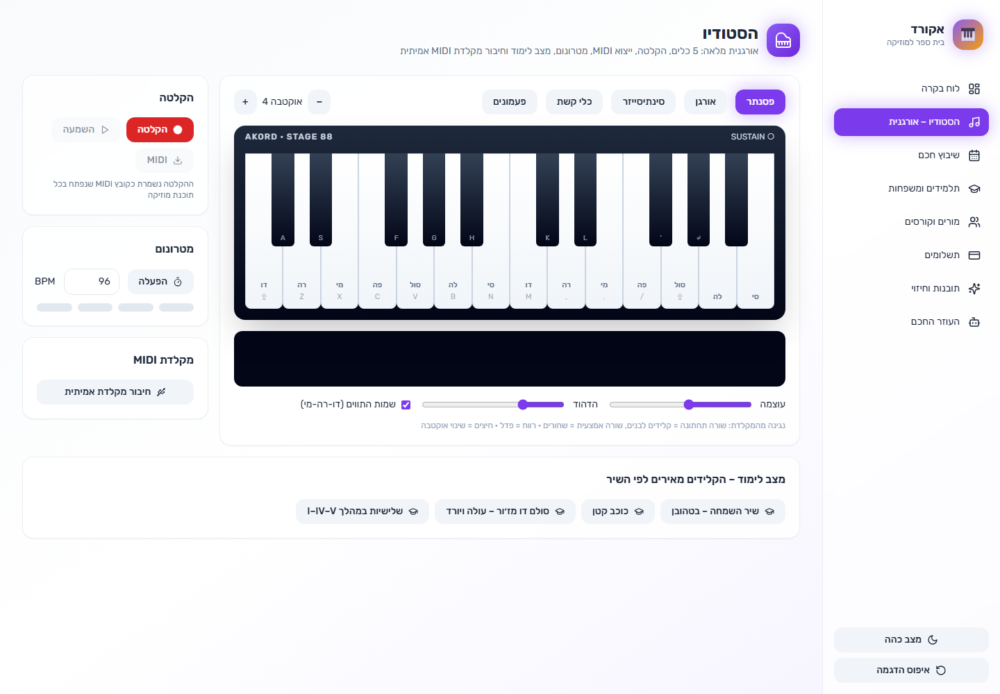
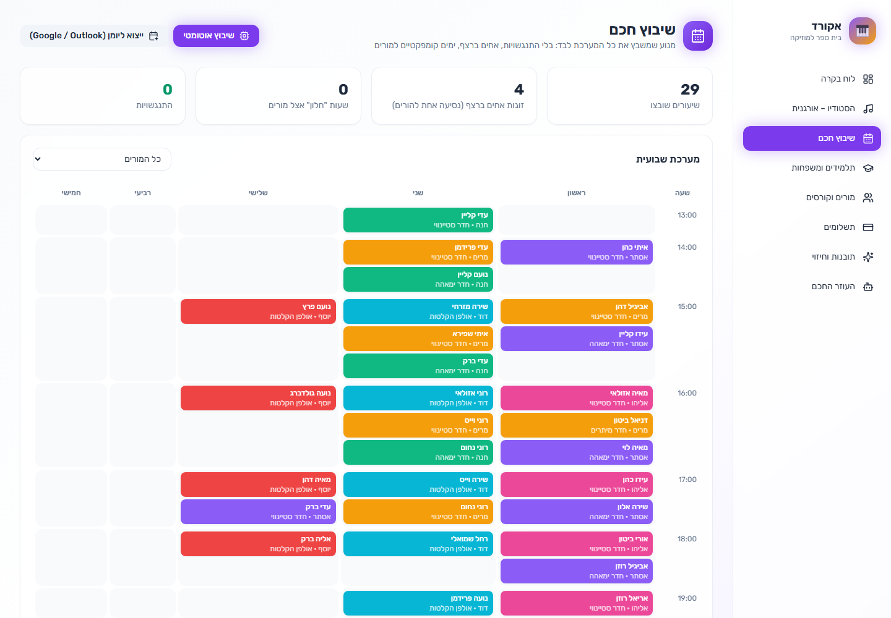
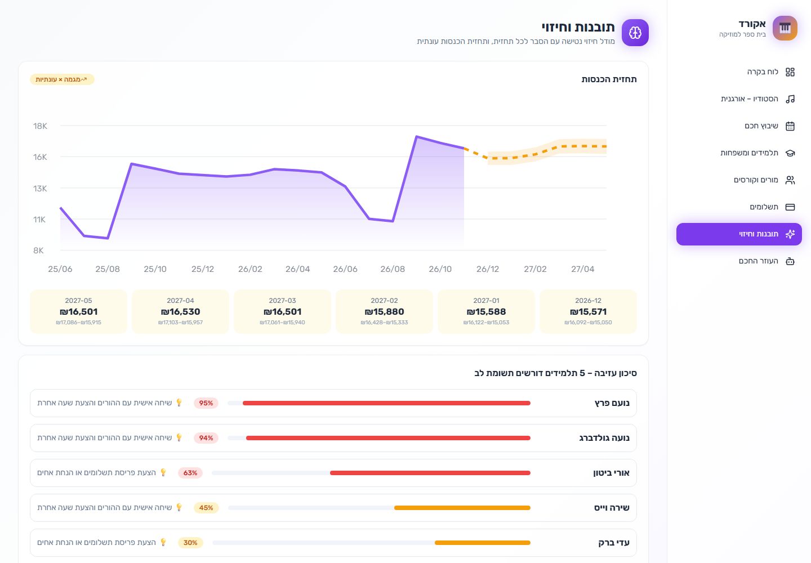
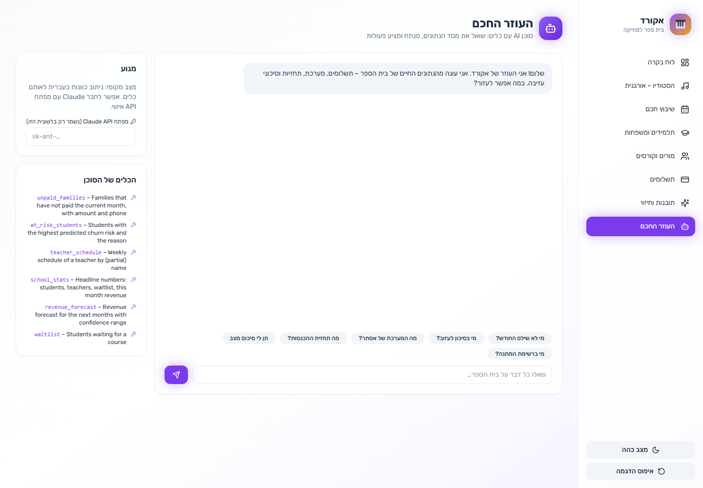
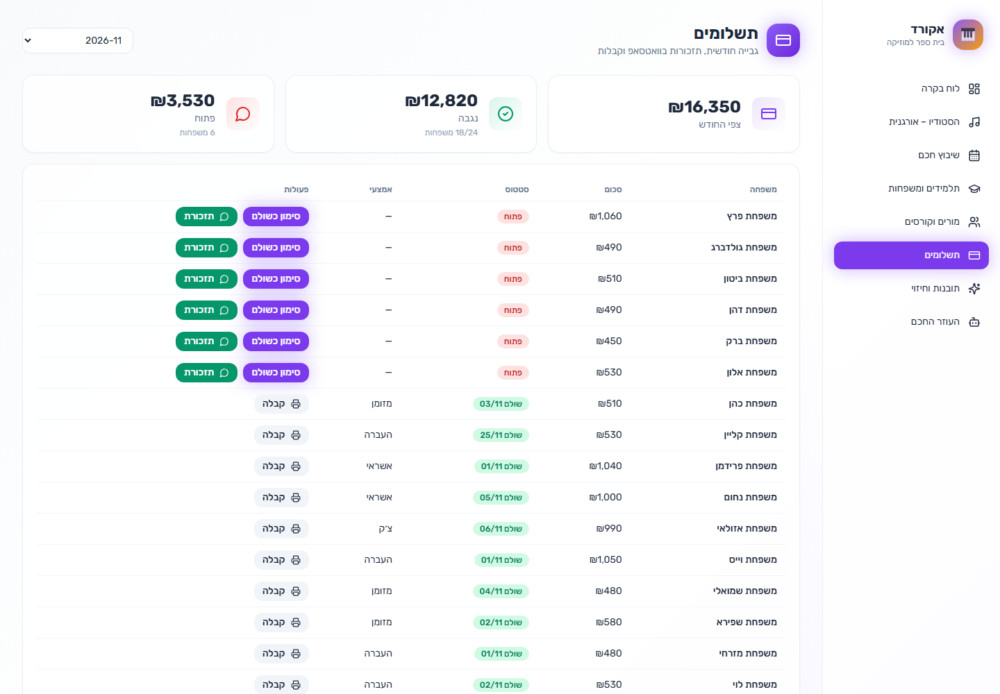

<div dir="rtl" align="right">

# 🎹 אקורד – פלטפורמה חכמה לניהול בית ספר למוזיקה

[](https://github.com/chavi-blizinsky/akord-music-academy/actions/workflows/ci.yml)

**🔗 אתר חי:** https://chavi-blizinsky.github.io/akord-music-academy/

מערכת Full Stack לניהול בית ספר למוזיקה: תלמידים ומשפחות, מורים, קורסים, תשלומים ומערכת שעות.
במרכזה **מנוע שיבוץ אוטומטי**, **מודל לחיזוי נטישה**, **תחזית הכנסות**, **סוכן AI עם כלים**, ו**סטודיו עם אורגנית** שמנגנת בדפדפן.

**צד שרת:** C# · ASP.NET Core 8 · Entity Framework Core · xUnit
**צד לקוח:** React 18 · TypeScript · Vite · Tailwind · Web Audio API · Web MIDI API

---

## ✨ מה יש במערכת

### 🎹 הסטודיו – אורגנית
| | |
|---|---|
| **5 כלים** | פסנתר, אורגן, סינתיסייזר, כלי קשת ופעמונים. כל כלי בנוי מאוסילטורים, מעטפת ADSR ופילטר (Web Audio API) |
| **נגינה מהמקלדת** | שורה תחתונה לקלידים הלבנים, שורה אמצעית לשחורים, רווח לפדל וחיצים לשינוי אוקטבה |
| **זיהוי אקורדים** | מזהה בזמן אמת מז׳ור, מינור, 7, maj7, m7, מוקטן, מוגדל ו-sus, בכל היפוך |
| **הקלטה** | הקלטה, השמעה חוזרת וייצוא לקובץ **MIDI** שנפתח בכל תוכנת מוזיקה |
| **מצב לימוד** | הקליד הבא נדלק לפי השיר, ומחושב אחוז הדיוק |
| **מטרונום ואוסילוסקופ** | מטרונום עם הדגשת פעמה ותצוגה חיה של גל הקול |
| **מקלדת אמיתית** | חיבור מקלדת MIDI פיזית דרך Web MIDI |



### 📅 שיבוץ חכם
פתרון בעיית אילוצים (CSP) עם backtracking, סדר משתנים MRV ו-beam search:
- **אילוצים קשיחים:** זמינות המורה, אין כפל הזמנה של מורה, תלמיד או חדר, החדר מתאים לכלי, וילדים מתחת לגיל 9 מסיימים לפני 18:00.
- **העדפות:** **אחים ברצף**, כדי שההורים ייסעו פעם אחת. ימי עבודה קומפקטיים למורים, ופחות שיעורים מאוחרים.
- גרירה ידנית של שיעורים, עם בדיקת התנגשויות מיידית.
- ייצוא ליומן **Google / Outlook / Apple**: קובץ iCalendar (RFC 5545) עם חזרה שבועית.



### 🧠 חיזוי ותובנות
- **חיזוי נטישה:** רגרסיה לוגיסטית על היעדרויות, מגמת היעדרות, איחורי תשלום, ותק ורמה. כל תחזית מגיעה **עם הסבר**: כמה כל גורם תרם, ומה הפעולה המומלצת.
- **תחזית הכנסות:** מגמה ליניארית כפול מדד עונתי לכל חודש, עם טווח ביטחון של 95% שמתרחב עם הזמן.



### 🤖 העוזר החכם – סוכן AI עם כלים
הסוכן עונה מהנתונים החיים, למשל "מי לא שילם החודש?", "מי בסיכון לעזוב?" או "מה המערכת של אסתר?".
- **עם מפתח Claude:** המודל בוחר בעצמו באילו כלים להשתמש (tool use loop).
- **בלי מפתח:** נתב כוונות בעברית מפעיל את אותם כלים, כך שהסוכן תמיד עונה.
- בשרת ה-endpoint מוגן ב-**Rate Limiting**.



### 💳 תשלומים ואינטגרציות
- גבייה חודשית, סימון תשלום, **תזכורת בוואטסאפ** בלחיצה (עם הודעה מוכנה), וקבלה להדפסה.
- **ייצוא לאקסל:** CSV עם BOM, כדי שהעברית תוצג נכון.



---

## 🏗️ ארכיטקטורה

```
akord-music-academy/
├── server/                       ASP.NET Core 8 – שלוש שכבות
│   ├── src/Akord.Api             Controllers, Swagger, ProblemDetails, Rate Limiting, Health checks
│   ├── src/Akord.BL              לוגיקה עסקית: Scheduler, Insights (churn + forecast), Assistant, Calendar
│   ├── src/Akord.DAL             Entity Framework Core + SQLite, מודל נתונים ו-Seeder
│   └── tests/Akord.Tests         xUnit: בדיקות יחידה לאלגוריתמים + בדיקות API מקצה לקצה (WebApplicationFactory)
├── client/                       React + TypeScript
│   ├── src/engine                scheduler · churn · forecast · assistant (אותם אלגוריתמים כמו בשרת)
│   ├── src/studio                synth (Web Audio) · theory (אקורדים, כתיבת קובץ MIDI)
│   └── src/pages                 מסכי המערכת
└── .github/workflows/ci.yml      בנייה ובדיקות לשרת ולקליינט, ופריסה אוטומטית ל-GitHub Pages
```

### API (Swagger ב-`/swagger`)
| Method | Endpoint | תיאור |
|---|---|---|
| GET | `/api/students?status=&q=` | תלמידים עם סינון וחיפוש |
| POST | `/api/students` | הוספת תלמיד (ולידציה + ProblemDetails) |
| GET | `/api/schedule?teacherId=` | מערכת שבועית |
| POST | `/api/schedule/solve` | הרצת מנוע השיבוץ ושמירה בטרנזקציה |
| GET | `/api/schedule/calendar.ics` | יומן iCalendar |
| GET | `/api/payments/{month}` · POST `/api/payments/{id}/paid` | גבייה |
| GET | `/api/insights/churn` · `/api/insights/forecast` | חיזוי |
| POST | `/api/assistant` | סוכן ה-AI (Rate Limited) |
| GET | `/health` | בדיקת תקינות, כולל מסד הנתונים |

---

## 🚀 הרצה מקומית

```bash
# שרת – http://localhost:5000/swagger
cd server
dotnet run --project src/Akord.Api
dotnet test

# לקוח – http://localhost:5173
cd client
npm install
npm run dev
npm test
```

כדי להפעיל את Claude בשרת, מגדירים את המפתח כ-user secret (לא בקוד):
`dotnet user-secrets set "Claude:ApiKey" "<key>" --project src/Akord.Api`

> האתר החי רץ במצב הדגמה: הנתונים נשמרים בדפדפן, ו"איפוס הדגמה" מחזיר אותם להתחלה.

</div>
